# DAY 1 시간표 · 10월 14일(수) 18:30–21:00

오늘은 **강의와 실습을 번갈아** 합니다. 짧게 듣고 바로 해 보고, 해 본 것을 다시 강의로 정리합니다.

```mermaid
gantt
    dateFormat HH:mm
    axisFormat %H:%M
    tickInterval 30minute
    section 실습
    준비 · 과제 고르기      :p0, 18:30, 10m
    STEP 2 사람이 지휘     :p1, 19:00, 20m
    STEP 3 AI에게 위임     :p2, 20:05, 20m
    관찰 기록             :p3, 20:25, 10m
    section 강의
    에이전트란            :l1, 18:40, 20m
    최신 사례             :l2, 19:20, 15m
    일하는 방식            :l3, 19:45, 20m
    section 공유
    결과 함께 보기         :s1, 20:35, 15m
    Form · 내일 예고       :s2, 20:50, 10m
    section 휴식
    휴식                 :b1, 19:35, 10m
```

## 시간대별로 할 일

| 시각 | 구분 | 내가 할 일 | 열어 둘 파일 |
| --- | --- | --- | --- |
| 18:30–18:40 | 실습 | AI 서비스에 로그인하고, 관통 과제(A~D) 하나 고르기 | [`README.md`](README.md#관통-과제-고르기), [`data/fill_in_examples.md`](data/fill_in_examples.md) |
| 18:40–19:00 | 강의 | 생성형 AI와 AI 에이전트는 무엇이 다른가 · **STEP 1 맛보기**: 질문 한 줄 던져 보기 | [`prompts/step1.md`](prompts/step1.md) |
| 19:00–19:20 | 실습 | **STEP 2**: 조사 → 분석 → 정리 → 작성을 한 단계씩 4번 지시 | 고른 과제의 프롬프트 파일 |
| 19:20–19:35 | 강의 | 최신 AI 에이전트 서비스와 사례 · 리서치 에이전트 시연 | — |
| 19:35–19:45 | 휴식 | STEP 2를 못 끝냈다면 이때 마무리 | |
| 19:45–20:05 | 강의 | 에이전트가 일하는 방식 · **위임 프롬프트 6요소** | [`prompts/delegation_card.md`](prompts/delegation_card.md) |
| 20:05–20:25 | 실습 | **STEP 3**: **새 대화**에서 목표·기준·제약만 주고 한 번에 맡기기 | 고른 과제의 프롬프트 파일 |
| 20:25–20:35 | 실습 | 관찰 기록표 채우고 옆 사람과 비교 | [`worksheets/observation_sheet.md`](worksheets/observation_sheet.md) |
| 20:35–20:50 | 공유 | 대표 결과 함께 보기 · 정답 요소표로 내 결과 점검 | [`data/meeting_notes_answer_key.md`](data/meeting_notes_answer_key.md) |
| 20:50–21:00 | 마무리 | Google Form 제출 · DAY 2 예고 | [`worksheets/form_questions.md`](worksheets/form_questions.md) |

**제출:** https://forms.gle/HMGb6EAnjdK2hz16A — 5번 '다음에 자동화하고 싶은 부분'이 내일 실습의 재료입니다.

## 완주 기준

STEP 2와 STEP 3을 모두 해 보고, 관찰 기록표 첫 줄('다음 단계를 정한 것은 누구?')을 채우고, Form을 내면 완주입니다.

## 빨리 끝났다면 · 늦어졌다면

| 상황 | 이렇게 |
| --- | --- |
| STEP 3이 일찍 끝났다 | 기준 하나를 바꿔 다시 맡겨 보기 ([`homework.md`](homework.md) 확장 과제) · 다른 가상 회의록으로 해 보기 ([`data/meeting_notes_more.md`](data/meeting_notes_more.md)) |
| 개발 경험이 있다 | [`advanced/`](advanced/)의 서비스 비교 또는 Tool Calling 모의 실행 |
| STEP 2가 휴식 전까지 안 끝났다 | 휴식 시간에 마무리하고, 강의 뒤 STEP 3으로 바로 넘어가면 됩니다 |
| 시간 안에 다 못 했다 | [`homework.md`](homework.md)의 짧은 복습 코스로 집에서 이어서. Form은 오늘 밤까지 내 주세요 |
