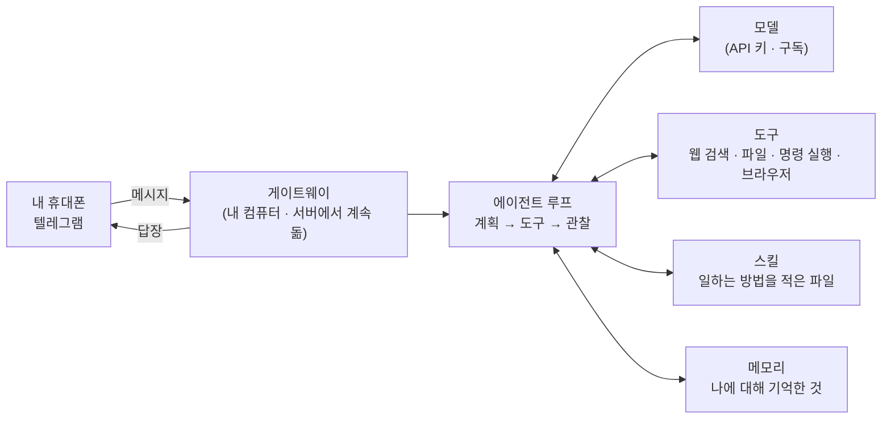

# 심화 1 · OpenClaw 또는 Hermes 직접 설치

강의에서 강사가 시연한 개인 AI 비서를 **본인 노트북에** 직접 띄워 봅니다. 둘 중 하나만 하면 됩니다. **수업 중에는 강사 시연으로 충분하고, 설치는 집에서 아래 수칙을 보며 천천히** 하세요.

> **Docker Desktop은 필요 없습니다.** 두 도구 모두 데스크톱 앱이나 설치 명령 한 줄로 설치됩니다. Docker를 이미 쓰는 분만 Docker로 띄우세요. 에이전트가 내 컴퓨터와 분리되어 더 안전합니다.

> **강의에서 본 장면을 그대로 따라 하려면** [`../demo/1_hermes_openclaw.md`](../demo/1_hermes_openclaw.md)의 메시지 6개(일 맡기기 → 실행 → 피드백 → 기억 확인 → 안전 테스트 → 권한 테스트)를 쓰세요. 이 파일은 구조 · 차이 · 운영 · 응용을 다룹니다.

## 메신저 비서는 어떻게 생겼나



| 부품 | 하는 일 | 범용 AI(Claude · ChatGPT)와 비교 |
| --- | --- | --- |
| 게이트웨이 | 메신저와 에이전트를 잇고, **계속 켜져 있으면서** 메시지를 기다림 | 범용 AI는 내가 창을 열어야 시작 |
| 채널 | 텔레그램 · 디스코드 · 슬랙 · 왓츠앱 등 말을 거는 통로 | 범용 AI는 그 회사 앱 · 웹 |
| 모델 | 판단하는 두뇌. **내가 고르고 바꿀 수 있음** | 범용 AI는 그 회사 모델 |
| 도구 | 웹 검색, 파일, 명령 실행, 브라우저 등 | 범용 AI는 회사가 허용한 도구 · 커넥터 |
| 스킬 | '이런 일은 이렇게 한다'를 적은 파일. 설치하거나 스스로 만듦 | 범용 AI의 프로젝트 지시문 · Skills와 비슷 |
| 메모리 | 대화가 끝나도 남는 기억 | 범용 AI의 메모리 기능과 비슷 |

**[심화 4 미니 에이전트 루프](4_agent_loop/)**의 150줄 코드가 이 그림의 가운데(에이전트 루프)를 줄여 놓은 것입니다.

## OpenClaw와 Hermes는 무엇이 다른가

| | OpenClaw | Hermes Agent |
| --- | --- | --- |
| 만든 곳 | 오픈소스 커뮤니티 | Nous Research |
| 특징 | 이미 만들어진 **스킬을 골라 설치**해 넓게 쓰는 비서 | 일을 끝낸 뒤 **스스로 스킬을 만들어** 다음에 다시 쓰는 비서 |
| 이럴 때 | 여러 메신저 · 서비스에 연결해 다양한 일을 시키고 싶을 때 | 같은 종류의 일을 반복시키며 점점 나아지는지 보고 싶을 때 |
| 강의에서 본 것 | 설치된 스킬 목록, 로그의 도구 호출 | 갓 설치한 상태에서 일을 시킨 뒤 새로 생긴 스킬 파일 |
| 비용 관점 | 모델 사용료(API 키) 또는 ChatGPT 구독 | 모델 사용료. 스킬을 만드는 과정에서 토큰을 더 쓸 수 있음 |

둘 다 **내 컴퓨터 · 서버에서 돌고, 명령 실행 · 파일 접근 같은 강한 도구**를 가집니다. 그래서 '어디에 깔고 무엇을 허용할지'가 범용 AI보다 훨씬 중요합니다.

## 설치 방법 고르기

| 방법 | OpenClaw | Hermes Agent |
| --- | --- | --- |
| **데스크톱 앱 (추천)** | Windows: [Windows Hub 설치 파일](https://github.com/openclaw/openclaw-windows-node/releases/latest) · macOS: [릴리스](https://github.com/openclaw/openclaw/releases)의 `.dmg` | [Hermes 설치 안내](https://hermes-agent.nousresearch.com/docs/getting-started/installation/)의 데스크톱 앱 (macOS는 Apple Silicon만) |
| 설치 명령 (Windows PowerShell) | `iwr -useb https://openclaw.ai/install.ps1 \| iex` | `iex (irm https://hermes-agent.nousresearch.com/install.ps1)` |
| 설치 명령 (macOS · Linux) | `curl -fsSL https://openclaw.ai/install.sh \| bash` | `curl -fsSL https://hermes-agent.nousresearch.com/install.sh \| bash` |
| Docker (이미 쓰는 분) | [OpenClaw 설치 문서](https://docs.openclaw.ai/install)의 Docker 안내 | [Hermes 설치 안내](https://hermes-agent.nousresearch.com/docs/getting-started/installation/) 참고 |

- 설치 명령은 인터넷에서 받은 스크립트를 바로 실행합니다. **주소가 위의 공식 주소인지 한 번 더 확인**하세요.
- 설치 방법은 버전마다 바뀝니다. 막히면 공식 문서([OpenClaw](https://docs.openclaw.ai/install) · [Hermes](https://hermes-agent.nousresearch.com/docs/getting-started/installation/))를 기준으로 합니다.

## 내 노트북에 깔 때 지킬 것

OpenClaw·Hermes는 명령을 실행하고 파일을 읽고 쓸 수 있는 에이전트입니다. Docker 없이 깔면 내 노트북 전체에 닿을 수 있으니 세 가지를 지킵니다.

1. **개인 메일·드라이브·회사 계정을 연결하지 않습니다.** 텔레그램 봇과 모델 키만 씁니다.
2. **명령 실행·파일 쓰기는 '승인 후 실행'** 으로 둡니다. 지시문에 "묻고 해"라고 적는 것은 권한 통제가 아닙니다. 설정으로 승인 모드를 켤 수 없다면 내 노트북에 깔지 말고 별도 컴퓨터·가상 머신·Docker에서 씁니다.
3. **끝나면 정리합니다.** 봇 토큰과 API 키를 폐기하고, 계속 쓰지 않으면 앱을 지웁니다.

## 연결하고 확인하기

| 항목 | OpenClaw | Hermes Agent |
| --- | --- | --- |
| 첫 설정 | 설치 뒤 나오는 안내(onboard)를 따라 모델·메신저 연결 | 설치 뒤 `hermes setup` |
| 모델 연결 | 개인 API 키, 또는 ChatGPT 구독 로그인 ([공식 문서](https://docs.openclaw.ai/providers/openai)) | 개인 API 키, **ChatGPT 구독 로그인**(`hermes model`에서 OpenAI Codex), GitHub Copilot, Nous Portal(`hermes setup --portal`), 내 컴퓨터의 Ollama 등 ([공식 문서](https://hermes-agent.nousresearch.com/docs/integrations/providers)) |
| 메신저 | 텔레그램 @BotFather에서 봇 토큰 발급 후 등록 | `hermes gateway setup`으로 텔레그램 등록 후, 설정 마지막 안내대로 게이트웨이 켜기 |
| 확인 | 내 봇에 시나리오 카드의 일을 말로 시켜 보기 | 일을 끝낸 뒤 새 스킬 파일이 생겼는지 확인 |

- **이미 ChatGPT를 구독 중이면** 두 도구 모두 그 구독으로 로그인해 별도 사용료 없이 써 볼 수 있습니다. 어느 플랜까지 되는지, 구독 한도에서 어떻게 차감되는지는 공식 문서에 나와 있지 않으니 처음에는 짧게 써 보고 확인합니다.
- **Claude 구독:** Pro로는 연결할 수 없습니다. Hermes 문서에 따르면 Max는 '추가 사용량(extra usage)'을 따로 구매한 경우에만 로그인 연결이 되고, 그 사용량은 별도로 과금됩니다. 그 밖에는 API 키로 연결합니다.
- **완전 무료로 하려면:** 내 컴퓨터에서 Ollama로 오픈 모델을 돌려 연결합니다. 다만 도구를 잘 쓰는 모델은 메모리가 넉넉한 컴퓨터가 필요합니다. Gemini 무료 API 키는 Hermes 문서에서도 "에이전트 대화 몇 번 만에 소진될 수 있다"고 안내합니다.
- 텔레그램 봇 토큰도 비밀번호입니다. 화면 공유 중에 띄우지 않습니다.

## 자주 쓰는 운영 명령

공식 설치 문서에서 확인한 명령입니다. 버전에 따라 바뀔 수 있습니다.

| 하고 싶은 것 | OpenClaw | Hermes Agent |
| --- | --- | --- |
| 버전 · 설치 확인 | `openclaw --version` | `hermes doctor` |
| 설정 점검 | `openclaw doctor` | `hermes config check` |
| 게이트웨이가 도는지 | `openclaw gateway status` | — |
| 모델 바꾸기 | 처음 설정(`openclaw onboard`)에서 | `hermes model` |
| 쓸 도구 고르기 | — | `hermes tools` |
| 메신저 연결 | 처음 설정에서 채널 선택 | `hermes gateway setup` |
| 업데이트 | `openclaw update --channel stable` | `hermes update` |
| 백업 | — | `hermes backup` |

**`hermes tools`로 도구를 줄여 보세요.** 실습 비서에게 명령 실행 · 브라우저 도구가 꼭 필요한지 생각해 보고, 필요 없는 것은 끕니다. 도구를 줄이는 것이 가장 확실한 권한 관리입니다.

## 봇에게 처음 보낼 말

시나리오 카드가 있으면 프로젝트 지시문을 그대로 보내면 됩니다. 막막하면 아래 중 하나를 보내세요.

```
너는 내 개인 비서야. 앞으로 내가 "브리핑"이라고 하면, 최근 7일 AI 에이전트 뉴스 중 공공 행정 실무자에게 중요한 3개를 골라 제목 · 한 줄 이유 · 링크로 알려 줘. 출처 없는 내용은 쓰지 마.
```

```
너는 내 회의 정리 비서야. 내가 회의록을 보내면 결정 사항, 결정하지 못한 사항, 할 일(담당·마감)을 표로 정리해 줘. 회의록에 없는 담당·마감은 '미정'으로 둬.
```

**기억 확인:** 한참 뒤에 `브리핑`이라고만 보내 보세요. 처음 설명한 형식대로 나오면 비서가 기억하고 있는 것입니다. Hermes라면 이때 새 스킬 파일이 생겼는지도 봅니다.

## 응용 레시피 5개 · 메신저 비서라서 좋은 일

범용 AI 창을 열지 않고 **휴대폰 메신저로 말 한마디**에 일이 되는 것이 메신저 비서의 장점입니다. 처음 보낸 규칙을 기억하는지, 같은 일을 반복할 때 나아지는지 봅니다.

| 레시피 | 처음 한 번 보낼 규칙 | 이후에는 이렇게만 | 볼 것 |
| --- | --- | --- | --- |
| 1 · 뉴스 브리핑 | 위의 '브리핑' 규칙 | `브리핑` | 형식을 기억하나, 피드백을 반영하나 |
| 2 · 회의록 정리 | 위의 회의 정리 비서 규칙 | 회의록 붙여 넣기 | '미정' 처리를 매번 지키나 |
| 3 · 이동 중 메모 정리 | `내가 "메모:"로 시작하는 말을 보내면 할 일 · 아이디어 · 기타로 나눠 모아 두고, "메모 정리"라고 하면 지금까지 모은 것을 표로 보여 줘.` | `메모: 금요일 출장 KTX 예매` | 대화가 이어져도 모아 둔 메모를 기억하나 |
| 4 · 일정 점검 | `내가 일정표를 보내면 겹치는 일정과 30분 미만 이동을 찾아 경고 3개 이내로 알려 줘. 일정은 절대 바꾸지 마.` | DAY 2 [가상 일정표](../data/sample_inputs.md#schedule) 붙여 넣기 | 계산이 맞나 (정답: 화 15:00 겹침, 수 이동 20분) |
| 5 · 스킬 만들기 관찰 (Hermes) | 레시피 1을 세 번 반복하고 매번 피드백 한 가지 | `브리핑` | 스킬 파일이 생기거나 바뀌나, 바뀐 내용이 피드백을 반영하나 |

**하지 말 것:** 메일 보내기 · 결제 · 파일 삭제를 메신저 한마디로 맡기지 않습니다. 휴대폰을 잃어버리거나 메신저 계정이 털리면, 그 비서가 할 수 있는 모든 일이 남의 손에 넘어갑니다.

## 비용 관리

- 메신저 비서는 **계속 켜져 있고**, 일을 할 때마다 모델 사용료가 나갑니다. 스킬을 만들거나 웹을 여러 번 검색하면 한 번에 더 많이 씁니다.
- **선불 크레딧을 소액 충전하고 자동 충전을 끄는 것**이 가장 확실한 상한입니다. 콘솔의 사용량 화면을 실습 전후로 한 번씩 봅니다.
- 오래 쓸 계획이 없으면 실습이 끝난 날 게이트웨이를 끄고 키를 폐기합니다.

## 끝내기

실습이 끝나면 쓰지 않는 봇 토큰과 API 키를 폐기합니다. 앱으로 깔았다면 계속 쓰지 않을 때 앱을 지우고, Docker로 띄웠다면 컨테이너를 멈춥니다(`docker compose down` 등).
