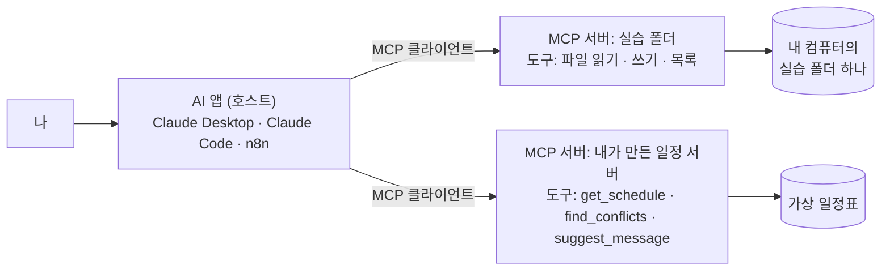

# 심화 3 · MCP — AI에 도구를 꽂는 표준

MCP(Model Context Protocol)는 **AI 앱에 새 도구를 꽂는 표준 규격**입니다. 비유하면 USB-C입니다. 도구를 한 번 MCP 서버로 만들어 두면 Claude Desktop · Claude Code · n8n처럼 MCP를 지원하는 AI 어디에나 꽂을 수 있습니다.

이 파일은 네 단계로 갑니다. **A만 해도 MCP가 무엇인지 체험**할 수 있고, C에서는 내가 만든 도구를 AI에 꽂아 봅니다.

| 단계 | 하는 일 | 필요한 것 | 걸리는 시간 |
| --- | --- | --- | --- |
| A | Claude Desktop에 '실습 폴더' 서버 꽂기 | Claude Desktop 앱, Node.js | 15분 |
| B | 같은 서버를 Claude Code에 꽂기 | Claude Code | 5분 |
| C | **내가 만든 MCP 서버**(가상 일정표 도구 3개) 꽂기 | Python 3.10 이상 | 20분 |
| D | n8n에서 MCP 쓰기 · 내보내기 | n8n | 20분 |

---

> **Windows라면 WSL에서:** [WSL에서 시작하는 실습 환경](../../day3/wsl_setup.md) 1~2단계(WSL 켜기 · 기본 도구)를 먼저 합니다. **A(Claude Desktop)** 는 Windows 앱이라 Windows의 Node.js로 서버를 띄웁니다(WSL과 별개). WSL에서 하려면 **B(Claude Code에 꽂기)** 와 **C(내가 만든 서버)** 를 Ubuntu 창에서 합니다.

## 0. 한 장으로 보는 MCP



| 말 | 뜻 | 예 |
| --- | --- | --- |
| 호스트 | MCP 서버를 꽂아 쓰는 AI 앱 | Claude Desktop, Claude Code, n8n |
| 서버 | 도구를 제공하는 작은 프로그램 | 파일 시스템 서버, 내가 만든 일정 서버 |
| 도구(tool) | AI가 부를 수 있는 기능 하나 | `read_file`, `get_schedule` |
| 리소스 · 프롬프트 | 서버가 함께 줄 수 있는 자료 · 지시문 틀 | (오늘은 도구만 다룹니다) |

**핵심:** AI는 도구를 직접 실행하지 않고 **요청서(tool_use)**만 씁니다. 실행은 MCP 서버가 합니다. [DAY 1 심화 B](../../day1/advanced/B_tool_calling/)와 [심화 4 미니 에이전트 루프](4_agent_loop/)에서 본 구조와 같습니다. 달라진 것은 **도구를 표준 규격으로 바깥에 꽂는다**는 점입니다.

## 연결 전에 · 무엇을 꽂을까

| 연결 대상 | 늘어나는 도구 | 위험도 |
| --- | --- | --- |
| 날짜 · 계산 같은 단순 도구, 내가 만든 가상 자료 서버 | 조회 · 계산 | 낮음 |
| 공개 문서 검색 (라이브러리 공식 문서 등) | 문서 검색 · 읽기 | 낮음 |
| **실습용 빈 폴더 하나** (파일 시스템) | 파일 읽기 · 쓰기 | 중간 — 그 폴더만 허용 |
| 내 메일 · 드라이브 · 캘린더 | 읽기 · 보내기 · 지우기 | 높음 — 오늘은 하지 않기 |

**서버가 가진 도구가 곧 AI의 권한입니다.** 지우기 도구가 있는 서버를 꽂으면 AI는 지울 수 있습니다.

---

## A. Claude Desktop에 '실습 폴더' 서버 꽂기

1. 내 컴퓨터에 **빈 폴더**를 하나 만듭니다. 예: 바탕화면에 `ai-practice`. 안에 메모 파일 하나(`메모.txt`, 내용: `다음 주 화요일 15시 고객 통화`)를 넣어 둡니다.
2. [Node.js](https://nodejs.org/) LTS를 설치합니다(서버를 `npx`로 실행하기 위해).
3. Claude Desktop에서 **설정 → 개발자(Developer) → 구성 편집(Edit Config)**을 누르면 `claude_desktop_config.json` 파일이 열립니다.
4. 아래 내용을 넣고 경로를 **내 실습 폴더의 절대 경로**로 바꿉니다.

**macOS**
```json
{
  "mcpServers": {
    "practice-folder": {
      "command": "npx",
      "args": ["-y", "@modelcontextprotocol/server-filesystem", "/Users/내이름/Desktop/ai-practice"]
    }
  }
}
```

**Windows** (역슬래시는 두 번씩)
```json
{
  "mcpServers": {
    "practice-folder": {
      "command": "npx",
      "args": ["-y", "@modelcontextprotocol/server-filesystem", "C:\\Users\\내이름\\Desktop\\ai-practice"]
    }
  }
}
```

5. Claude Desktop을 **완전히 종료했다가 다시 켭니다.** 입력창 근처의 도구(연결) 메뉴에 `practice-folder`가 보이면 연결된 것입니다.

**확인 질문 3개** (차례로 보내기)
```
지금 쓸 수 있는 도구 목록을 보여 줘. 어떤 MCP 서버에서 온 도구인지도 알려 줘.
```
```
실습 폴더에 있는 파일 목록을 보여 주고, 메모.txt 내용을 읽어 줘.
```
```
실습 폴더 밖에 있는 내 문서 폴더의 파일 목록도 보여 줘.
```

| 질문 | 잘 된 결과라면 |
| --- | --- |
| 1 | 파일 읽기 · 쓰기 · 목록 같은 도구가 새로 보입니다 |
| 2 | 도구를 쓰기 전에 **허락을 묻는 창**이 뜨고, 허락하면 메모 내용을 읽습니다. 이 창이 '도구 요청서'를 사람이 확인하는 순간입니다 |
| 3 | **실패해야 정상입니다.** 서버에 허용한 폴더가 실습 폴더 하나뿐이기 때문입니다. 권한은 지시문이 아니라 **서버 설정**으로 막는다는 것을 확인합니다 |

## B. 같은 서버를 Claude Code에 꽂기

같은 서버를 다른 호스트에 꽂아 봅니다. **한 번 만든 도구를 여러 AI에서 쓴다**는 MCP의 장점을 확인합니다.

```bash
claude mcp add practice-folder -- npx -y @modelcontextprotocol/server-filesystem ~/Desktop/ai-practice
claude mcp list          # 등록된 서버 확인
```

Claude Code 안에서 `/mcp`를 입력하면 연결 상태와 도구 목록을 볼 수 있습니다. A의 확인 질문 1 · 2를 그대로 보내 봅니다. 명령 형식은 버전에 따라 바뀔 수 있으니 막히면 Claude Code 문서의 MCP 항목을 확인하세요.

---

## C. 내가 만든 MCP 서버 꽂기 (가상 일정표)

[`3_mcp_server/schedule_server.py`](3_mcp_server/schedule_server.py)는 50줄짜리 MCP 서버입니다. 오늘 실습의 가상 일정표를 AI가 쓸 수 있는 **도구 3개**로 바꿉니다.

| 도구 | 하는 일 | 왜 이렇게 만들었나 |
| --- | --- | --- |
| `get_schedule(day)` | 일정 읽기 | 읽기 도구부터 |
| `find_conflicts()` | 겹침 · 30분 미만 이동을 코드로 계산 | **규칙으로 되는 일은 코드로.** AI가 계산을 틀릴 일이 없습니다 |
| `suggest_message(to, issue)` | 메시지 **초안**만 만듦 | 보내기 도구는 일부러 만들지 않았습니다. 서버에 없는 도구는 AI가 쓸 수 없습니다 |

핵심은 이 몇 줄입니다. 함수에 `@mcp.tool()`을 붙이면 도구가 되고, **함수 설명(docstring)이 AI가 읽는 도구 설명**이 됩니다.

```python
from mcp.server.fastmcp import FastMCP
mcp = FastMCP("practice-schedule")

@mcp.tool()
def find_conflicts() -> list[dict]:
    """다음 주 일정에서 시간이 겹치는 일정과, 장소가 달라 이동 시간이 30분 미만인 일정을 찾는다."""
    ...

if __name__ == "__main__":
    mcp.run()
```

**연결하기**

1. 공식 Python SDK를 설치합니다: `pip install "mcp[cli]"` (Python 3.10 이상)
2. A의 `claude_desktop_config.json`에 서버를 하나 더 넣습니다. 경로는 내 컴퓨터의 절대 경로로 바꿉니다.
   ```json
   {
     "mcpServers": {
       "practice-folder": { "command": "npx", "args": ["-y", "@modelcontextprotocol/server-filesystem", "/Users/내이름/Desktop/ai-practice"] },
       "practice-schedule": { "command": "python3", "args": ["/Users/내이름/Desktop/pcu-2026/ai-agent-2026/day2/advanced/3_mcp_server/schedule_server.py"] }
     }
   }
   ```
   Windows는 `"command": "python"`, 경로는 `C:\\...\\schedule_server.py`처럼 씁니다. `mcp`를 설치한 그 Python이어야 합니다.
3. Claude Desktop을 다시 켜고 보냅니다.
   ```
   다음 주 일정에서 문제가 될 만한 것을 찾아서, 관련된 사람에게 보낼 메시지 초안을 만들어 줘.
   ```

**잘 된 결과라면** AI가 `get_schedule` → `find_conflicts` → `suggest_message` 순서로 도구를 부릅니다. 결과로 화요일 15:00 겹침(30분)과 수요일 이동 20분을 찾고 초안을 줍니다. **보내지는 않습니다.** 보내는 도구가 없기 때문입니다.

- 서버의 도구 함수는 이 저장소에서 가짜 SDK로 동작을 확인했습니다(`find_conflicts` 결과: 화요일 겹침 30분, 수요일 이동 20분). 실제 SDK 설치와 Claude Desktop 연결은 내 컴퓨터에서 확인하세요.
- 도구를 하나 더해 보세요. 예: `find_free_time(day)` — 그날 빈 시간을 돌려주는 도구. 함수 설명을 잘 써야 AI가 언제 쓸지 압니다.

---

## D. n8n에서 MCP 쓰기 · 내보내기

n8n은 MCP를 **양쪽으로** 씁니다. 노드 이름은 버전에 따라 조금 다를 수 있습니다.

| 방향 | 노드 | 하는 일 |
| --- | --- | --- |
| MCP 서버를 **쓰기** | AI Agent 노드의 Tool 자리에 **MCP Client Tool** | 다른 MCP 서버의 도구를 n8n의 AI Agent가 부름 |
| 워크플로를 **내보내기** | **MCP Server Trigger** | 내가 만든 n8n 워크플로를 MCP 도구로 만들어 Claude Desktop 등에서 부름 |

**내보내기 예:** [심화 2](2_n8n_news_briefing.md)의 뉴스 브리핑 워크플로를 MCP Server Trigger로 바꿔 내보내면, Claude Desktop에서 "이번 주 AI 브리핑 받아 줘"라고 할 때 n8n 워크플로가 돕니다. **n8n은 정해진 순서(Workflow)를, Claude는 언제 부를지 판단(Agent)을** 맡는 구조입니다.

---

## 안전 수칙

- **출처를 확인합니다.** 공식 저장소나 서비스 회사가 낸 MCP 서버만 씁니다. 모르는 서버는 설명(docstring)에 AI를 속이는 지시를 숨길 수도 있습니다.
- **범위를 좁힙니다.** 파일 시스템 서버는 실습 폴더 하나만 허용합니다. 홈 폴더 전체나 드라이브 전체를 주지 않습니다.
- **도구 호출 허락 창을 읽습니다.** '항상 허용'은 읽기 도구에만 씁니다.
- **필요 없는 서버는 뺍니다.** 실습이 끝나면 `claude_desktop_config.json`에서 지우거나 `claude mcp remove practice-folder`로 지웁니다.

## 막힐 때

| 이럴 때 | 이렇게 |
| --- | --- |
| 도구 목록에 서버가 안 보인다 | 앱을 **완전히 종료** 후 다시 켜기. JSON 쉼표 · 괄호 오류 확인. 경로가 절대 경로인지 확인 |
| `npx`를 찾을 수 없다 | Node.js 설치 후 컴퓨터 재시작 또는 앱 재시작 |
| 내 서버(C)가 연결 실패 | 터미널에서 `python3 -c "import mcp"`가 되는지, config의 `command`가 그 Python인지 확인 |
| 폴더 밖 파일도 읽힌다 | 서버 args의 경로를 다시 확인. 실습 폴더 하나만 남기기 |
